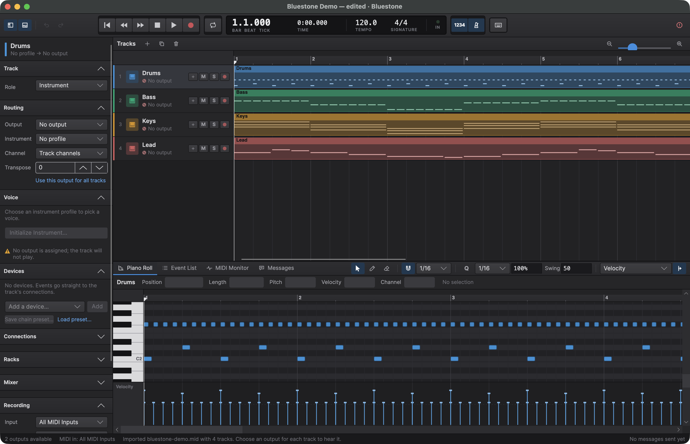

# Bluestone

[](https://github.com/djflan/Bluestone/actions/workflows/ci.yml)

Bluestone is an open-source, cross-platform DAW built around MIDI and real instruments. It sequences, records, and edits MIDI for hardware and software instruments, plays audio clips through a mixer, and hosts VST3 and CLAP plugins in separate processes, so a plugin that crashes cannot take the project down with it.

Bluestone started as a MIDI workstation for Yamaha XG instruments and the QY100, and that depth stays at its centre. It describes what an instrument understands independently from where MIDI is sent, so a track can use a device profile with physical hardware, a virtual MIDI port, a network destination, or a compatible software instrument.

> [!NOTE]
> Bluestone is an independent open-source project and is not affiliated with, authorized, sponsored, or endorsed by Yamaha Corporation. Yamaha, XG, QY100, and other product names and trademarks belong to their respective owners and are used solely to describe compatibility.



## Status

Bluestone is under active development and has no stable release yet. How it is built is described in [docs/architecture.md](docs/architecture.md), [docs/plugin-hosting.md](docs/plugin-hosting.md), and the [architecture decision records](docs/adr/).

### What works

**Sequencing and MIDI**

- Standard MIDI File import and export that reports anything it could not carry over ([docs/midi-files.md](docs/midi-files.md)).
- An arrangement of clips that can be moved, copied, trimmed, and split; a piano roll with velocity and controller lanes; an event list; automation lanes for controllers, pitch bend, and pressure.
- MIDI recording with count-in, metronome, punch in and out, cycle recording, and MIDI thru; the computer keyboard as a MIDI input.
- MIDI output through CoreMIDI, WinMM, and the ALSA sequencer, with SysEx kept byte for byte, and a built-in MIDI monitor.
- Device profiles for voices, controllers, initialization, and a parameter map that lets automation set an external instrument's parameters by controller, RPN, NRPN, or SysEx ([docs/profiles.md](docs/profiles.md), [ADR 0031](docs/adr/0031-hardware-parameter-automation.md)).
- Projects saved safely, with older project formats migrated so they play the same MIDI ([docs/project-format.md](docs/project-format.md)).

**Tracks, devices, and routing**

- Track roles (instrument, audio, hybrid, effect, group) that convert without losing content ([ADR 0021](docs/adr/0021-track-roles.md)).
- Group tracks that route their members, fold in the arrangement, and mute or solo everything in them ([ADR 0030](docs/adr/0030-group-tracks.md)).
- Device chains on tracks and in shared racks: built-in Transpose, Event Filter, and Arpeggiator devices and plugins, with bypass, reordering, parameters, and chain presets ([ADR 0022](docs/adr/0022-device-chains.md)).
- One routing model: connections from a track, or from after any device, to other tracks, racks, external instruments (by port and channel), mixer channels, and the master, with feedback loops refused ([ADR 0023](docs/adr/0023-signal-routing-model.md)).
- Device parameter automation ([ADR 0024](docs/adr/0024-device-automation.md)).
- Live input (MIDI thru, the computer keyboard, clicked piano keys) played through every device on the track's route, plugins included, without hanging notes when the route changes ([ADR 0035](docs/adr/0035-live-input-and-delay-compensation.md)).

**Audio** ([ADR 0032](docs/adr/0032-audio-engine.md))

- An audio engine (device output in Rust through cpal, the render graph in C#) that plays audio clips, plugin instruments, and plugin effects in time with MIDI.
- Audio clips from WAVE and AIFF files at any sample rate, streamed from disk, with clip gain and fades.
- A mixer with gain, pan, mute, solo, buses, and pre- or post-fader sends, and a mixer console with peak and RMS meters.
- Plugin latency compensated on every path, and a shorter render-ahead queue while a plugin instrument is played live ([ADR 0035](docs/adr/0035-live-input-and-delay-compensation.md)).
- A lost output device falls back to the default output and comes back when it returns.

**Plugins** ([docs/plugin-hosting.md](docs/plugin-hosting.md))

- VST3 and CLAP instruments, MIDI effects, and audio effects, run in worker processes through a Rust plugin host, with parameters, state saved in the project, and editors in their own windows ([ADR 0025](docs/adr/0025-out-of-process-plugin-hosting.md), [ADR 0033](docs/adr/0033-third-party-plugin-hosting.md)).
- Each plugin module is scanned in its own process; a module that crashes or hangs its scanner is quarantined until you retry it.
- A worker that crashes or hangs leaves Bluestone running: its plugins report it and go silent, and restart from their last state when you choose (or automatically, if you turn that on).
- Hosting modes choose which plugins share a worker: together, by manufacturer, by plugin (the default), or individually, with a choice per plugin ([ADR 0034](docs/adr/0034-plugin-hosting-modes.md)).
- Plugin MIDI effects are rendered into the playback plan, so their output is routed like any device's ([ADR 0028](docs/adr/0028-plugin-midi-effects-at-plan-time.md)).

### Not yet

- Audio input and audio recording.
- Compressed audio files (FLAC, MP3, Ogg, and others); only WAVE and AIFF play.
- Adding an audio clip or an external instrument from the app: both are read from and saved in project files, but there is no command to import an audio file or create an instrument. Tracks reach hardware through their own output and profile.
- Drawing device parameter automation in the arrangement (it plays from project files), and send or fader automation.
- MIDI input on Windows and Linux (the computer keyboard works everywhere), Windows MIDI Services, and device hot-plug on Windows and Linux.
- MIDI 2.0 and UMP, MPE, and per-note controllers.
- Plugin editors verified on Windows and Linux, editors embedded in the main window, plugins built for another processor architecture (no Rosetta worker), and SysEx to VST3 and CLAP plugins.
- A security sandbox for plugins: worker processes isolate crashes, not access ([SECURITY.md](SECURITY.md)).

Suggested next steps are in [docs/roadmap.md](docs/roadmap.md).

### Platform support

| Platform | MIDI output | MIDI input (recording, thru) | Audio output | VST3 and CLAP plugins |
| -------- | ----------- | ---------------------------- | ------------ | --------------------- |
| macOS (Apple silicon) | CoreMIDI: hardware, IAC, network, and Bluestone's own virtual port | CoreMIDI, with adapter timestamps | CoreAudio: heard and measured | Installed plugins tested, editors included |
| Windows (x64 in CI; ARM64 by hand) | WinMM: hardware ports and software synths, including SysEx, with measured timing | Computer keyboard only | WASAPI: built and tested in CI, not yet heard | Bluestone's test plugins in CI; editors not verified |
| Linux (x64 in CI) | ALSA sequencer: hardware, software synths, and Bluestone's own virtual port, including SysEx; not yet tried on a Linux desktop | Computer keyboard only | ALSA: built and tested in CI, not yet heard | Bluestone's test plugins in CI; editors not verified |

macOS is the development platform, with the native menu bar and a real-time playback thread. CI runners have no audio devices, so tests that need one skip there.

## Goals

- Hardware-first MIDI sequencing, recording, editing, and playback, alongside audio and plugins
- Reliable timing with measurable scheduling and audio behavior
- First-class, data-defined device profiles for voices, banks, controllers, effects, SysEx, and capabilities
- Independent MIDI endpoints for physical, virtual, and network destinations
- Plugins that cannot crash Bluestone: every third-party plugin runs out of process
- A portable project format that survives missing or renamed devices
- Standard MIDI File import and export with honest reporting of lossy conversions
- Accessible cross-platform desktop workflows
- A clean extension path for GM, GM2, XG, GS, and community-defined instruments

## Architectural principle

Bluestone separates a **device profile** from a **MIDI endpoint**:

```text
Track / logical part
        |
        +-- Device profile: what the instrument understands
        |      voices, banks, controllers, SysEx, capabilities
        |
        +-- MIDI endpoint: where messages are sent
               physical port, virtual port, network, software instrument
```

That makes all of these legitimate configurations:

```text
QY100 profile       -> physical QY100
QY100 profile       -> compatible XG software synth
Generic XG profile  -> physical XG module
GM/GM2 profile      -> arbitrary compliant endpoint
Custom profile      -> virtual MIDI port
```

Profiles are not ports, and ports are not instruments. Projects retain their musical intent even when a previously selected endpoint is unavailable. An external instrument states its profile once and has ports bound to endpoints; tracks reach its parts (a port and a channel) through connections, so one MU2000 can play sixteen tracks without each track repeating it.

In the same way, Bluestone models music, not a MIDI wire format. MIDI 1.0 is fully supported, MIDI 2.0/UMP is a planned protocol beside it, and SysEx is always preserved byte for byte whether or not Bluestone understands it. Universal SysEx, Yamaha XG, and Roland GS are recognized by separate dialect interpreters. [docs/architecture.md](docs/architecture.md) shows the layers, which project each concern belongs in, and the MIDI strategy.

## Technology direction

C# and .NET are the default for all of Bluestone: domain, sequencing, MIDI processing, routing, device chains, the audio render graph, persistence, plugin supervision, and the cross-platform UI. Platform adapters call operating-system MIDI services from C#.

Rust is used for a component only when a measurement shows managed code cannot meet a real-time or throughput requirement after tuning (allocation on the real-time path, callback deadlines, garbage collection pauses), or when a native interface such as plugin binaries requires it. It replaces C and C++ for new Bluestone-owned native code; C and C++ appear only as third-party libraries, vendor SDK requirements, or thin ABI shims. Native components sit behind a small, versioned C ABI, and vendor knowledge and domain rules stay in managed code. The Rust components are the audio device layer, `src/native/crates/bluestone_audio` ([ADR 0032](docs/adr/0032-audio-engine.md)), and the plugin host that loads VST3 and CLAP plugins in worker processes, `src/native/crates/bluestone_plugin_host` ([ADR 0033](docs/adr/0033-third-party-plugin-hosting.md)). See [ADR 0026](docs/adr/0026-native-technology-policy.md).

## Repository layout

```text
Bluestone/
├── CODE_OF_CONDUCT.md
├── CONTRIBUTING.md
├── LICENSE
├── README.md
├── SECURITY.md
├── global.json
├── nuget.config
├── docs/
│   ├── adr/                    Architecture decision records
│   ├── images/                 Screenshots used by the documentation
│   ├── architecture.md         Layers, project map, tracks, devices, routing, audio, and MIDI/SysEx strategy
│   ├── hardware-test-plan.md   Manual checks that need real instruments
│   ├── midi-files.md           Standard MIDI File behavior and diagnostics
│   ├── plugin-hosting.md       Out-of-process plugin hosting, hosting modes, crash recovery, and its limits
│   ├── profiles.md             Device profile format
│   ├── project-format.md       Bluestone project files, saving, and recovery
│   ├── roadmap.md              Status, what is not verified, and remaining work
│   └── windows-vst-loopback.md Playing a standalone VST host on Windows through a MIDI loopback port
├── profiles/                   Shipped device profiles (data, not code)
├── samples/                    Redistributable demo and fixture files
└── src/
    ├── dotnet/                 The .NET solution
    │   ├── Bluestone.slnx
    │   └── <ProjectFolder>/
    └── native/                 Bluestone-owned Rust crates (audio device layer, plugin host, test plugins), built by dotnet build
```

- `src/dotnet/Bluestone.slnx` is the solution entry point.
- Each .NET project belongs in its own direct child folder under `src/dotnet/`; [src/dotnet/README.md](src/dotnet/README.md) points to the project map.
- `src/native/` is one Cargo workspace; each Rust crate is a folder under `src/native/crates/`.
- `docs/adr/` records consequential architecture decisions.
- `profiles/` holds device profile data; see [profiles/README.md](profiles/README.md) for contribution rules.

Empty architectural layers should not be generated simply to match a diagram.

## Building

Install the [.NET 10 SDK](https://dotnet.microsoft.com/download) (10.0.300 or a later 10.0 feature band; see `global.json`) and a stable [Rust toolchain](https://rustup.rs) (edition 2024, so Rust 1.85 or later): `dotnet build` runs `cargo` for the crates in `src/native/`. On Linux, also install the ALSA development files (`sudo apt install libasound2-dev` on Debian and Ubuntu). Any editor works; in Visual Studio, use a version that supports .NET 10 and opens `src/dotnet/Bluestone.slnx`. From the repository root run:

```sh
dotnet restore src/dotnet/Bluestone.slnx
dotnet build src/dotnet/Bluestone.slnx
dotnet test src/dotnet/Bluestone.slnx
dotnet format src/dotnet/Bluestone.slnx --verify-no-changes
```

The native crates have their own tests and lints: `cargo test`, `cargo fmt --check`, and `cargo clippy --all-targets -- -D warnings` in `src/native/`.

Warnings are treated as errors and code style is enforced during build. Tests run on Microsoft.Testing.Platform. The default suite needs no MIDI hardware, audio device, or installed plugins: platform MIDI tests skip when their MIDI service is unavailable, audio device tests skip without an output device, and tests of installed third-party plugins skip when the plugin is missing.

Benchmarks and real-time probes live in `src/dotnet/Bluestone.Benchmarks`: BenchmarkDotNet workloads, a playback jitter probe, an audio callback probe, and a live-input latency probe. The last two play (silently) on the default audio output device.

```sh
dotnet run -c Release --project src/dotnet/Bluestone.Benchmarks -- --filter '*' --job Short
dotnet run -c Release --project src/dotnet/Bluestone.Benchmarks -- --jitter 10 --realtime
dotnet run -c Release --project src/dotnet/Bluestone.Benchmarks -- --audio 20 --pressure app --queue 1024
dotnet run -c Release --project src/dotnet/Bluestone.Benchmarks -- --live 20 --pressure app --buffer 128 --queue 1024 --live-queue 512
```

## Running Bluestone

```sh
dotnet run --project src/dotnet/Bluestone.Desktop
```

Without any hardware, route tracks to **Bluestone Monitor** and watch the messages in the MIDI
monitor panel, or route to **Bluestone Out** (macOS and Linux) and select it as the input of a software synth or DAW.
A demo song is included in `samples/bluestone-demo.mid`; drag it (or any `.mid` or `.bluestone` file)
onto the window to open it. Hardware checks are listed in
[docs/hardware-test-plan.md](docs/hardware-test-plan.md).

| Action | Shortcut |
| ------ | -------- |
| Play / stop | Space |
| Record (punch in and out while playing) / metronome | R / K |
| Return to start / go to end | Home / End |
| Previous / next bar | , / . |
| Cycle four bars from the playhead | L, or drag in the ruler's top strip |
| Panic (silence every output) | Ctrl/Cmd + . |
| Select tracks | Click; Shift-click for a range; Ctrl/Cmd-click to add or remove; ↑ / ↓ (Shift to extend) |
| Select all tracks | Ctrl/Cmd + A |
| Rename / mute / solo / delete selected tracks | Return / M / S / Delete |
| Add / duplicate tracks | Ctrl/Cmd + T / Ctrl/Cmd + D |
| Group the selected tracks | Ctrl/Cmd + G; right-click a track to add it to a group or remove it |
| Undo / Redo | Ctrl/Cmd + Z / Ctrl/Cmd + Shift + Z |
| New, Open, Save, Save As | Ctrl/Cmd + N, O, S, Shift + S |
| Import / Export MIDI | Ctrl/Cmd + I / E |
| Zoom timeline | Ctrl/Cmd + scroll, trackpad pinch, scroll over the bar ruler, or Ctrl/Cmd + = / − |
| Show inspector / piano roll / event list | I / P / D |
| Computer keyboard as MIDI input on / off | ` (backquote), or the keyboard button in the transport bar |
| Keyboard shortcut reference | Ctrl/Cmd + / |

### Editing notes

Double-click a clip (or press P) to open it in the piano roll, below the arrangement. A track's
music lives in clips; the piano roll edits one clip at a time and darkens the time outside it.

| In the arrangement | How |
| ------------------ | --- |
| Select clips | Click; Shift-click to add; Ctrl/Cmd-click to add or remove |
| Move / copy | Drag, also to another track (snapped to bars, or beats when zoomed in); Alt/Option-drag copies |
| Trim or extend | Drag a clip's left or right edge; trimmed notes are kept, just not played |
| New clip | Double-click empty space for a clip filling that bar (up to any neighbouring clip), or add notes in the piano roll on a track with no clips |
| Rename a clip | Double-click its name strip, or select it and press Return; clear the name to show the track's again |
| Split at the playhead / duplicate / delete | B / Ctrl/Cmd + D / Delete, with the arrangement focused (otherwise these act on tracks) |
| Automation lanes | The + on a track adds a lane (volume, pan, expression, modulation, sustain, brightness, pitch bend, pressure, or a parameter from the instrument's profile); the arrow shows or hides them |
| Automation points | Click to add, drag to move (Shift: no snapping), Alt/Option-click to delete, double-click to switch between hold and ramp |

| In the piano roll | How |
| ----------------- | --- |
| Arrow, pencil, eraser tools | 1 / 2 / 3, or the buttons in the pane header |
| Select | Click; Shift-click to add or remove; drag on empty space for a marquee; Ctrl/Cmd + A; Esc deselects |
| Add a note | Double-click, or click with the pencil (drag to set its length) |
| Move / copy / resize | Drag notes; Alt/Option-drag copies; drag a note's edge to resize; hold Ctrl/Cmd to ignore the grid |
| Nudge / transpose | ← → by a grid step (Shift: four), ↑ ↓ by a semitone (Shift: an octave) |
| Velocity | Drag stems in the velocity lane; draw a ramp with the pencil; Alt/Option + ↑ / ↓ |
| Controllers | Pick a lane (modulation, volume, pan, expression, sustain, pitch bend, pressure) and draw lines with the pencil; erase with the eraser |
| Quantize | Q (Shift + Q also quantizes note ends), with grid, strength, and swing in the header |
| Copy, cut, paste at the playhead, duplicate, delete | Ctrl/Cmd + C, X, V, D; Delete |
| Zoom time / key height | Ctrl/Cmd + scroll / Alt/Option + scroll |
| Exact values | Type a position, length, pitch, velocity, or channel in the strip above the notes |
| Hear a key | Click the keyboard; while recording, clicked keys play on the recording track and are recorded |

The event list (D) shows every event on the track with editable position, channel, data, and
length, filtered by kind, and shares its selection with the piano roll. Every edit is one undo step.

### Recording

Arm a track with its red button (or record into the selected track), then press R. From a stop,
Bluestone counts in (one or two bars) and starts recording; while playing, R punches in and out.
Space stops and adds the take as one undo step. Takes merge with what is there, or replace it
(**Recording ▸ Takes** in the inspector). With a cycle set, every pass is merged. MIDI thru plays
what you play through the armed or selected track's output, and the metronome clicks on that output
(or one you choose) while recording, or always if *Click while playing* is on. Recording uses
CoreMIDI input, so it works on macOS today.

### Computer keyboard

With no MIDI controller, turn on the computer keyboard (` or the keyboard button) to play notes.
It appears as the **Computer Keyboard** input, so it records, thrus, and shows in the monitor like
any other. The middle row plays white keys (A S D F G H J K L ; ') and the row above plays black
keys (W E T Y U O P). Z / X change octave and C / V change velocity; the transport bar shows the
channel, octave, velocity, and last note. Notes go to the recording, armed, or selected track's
channel (the channel its output forces, else the channel of its first event), and a note always releases on
the channel it started on. Keys are matched by position, so the layout works on any keyboard
language; other shortcuts are unavailable for the mapped keys while it is on.

While stopped, Bluestone sends each track's bank, program, and controller state at the playhead, so
what you play through thru uses the track's instrument without pressing play first.

### Tracks, devices, and routing

The inspector (I) edits the selected tracks. With several selected, a change applies to all of them
at once (one undo step), and values that differ show *Mixed*.

- **Track**: the role. Changing it never removes clips, devices, automation, or routing; Bluestone asks or refuses when it would.
- **Routing** and **Voice**: the MIDI output, the instrument profile, the channel, transposition, and the bank and program. **Initialize Instrument…** sends the profile's setup messages and asks before anything that resets the instrument.
- **Devices**: the track's device chain. Pick a built-in device or a scanned plugin in *Add a device…*; each device can be bypassed, moved, removed, and its parameters set. *Route from here…* sends a device's output elsewhere. *Save chain preset…* and *Load preset…* keep a chain for reuse.
- **Connections**: what the track sends to and receives from, and new connections from the track or one of its devices to a track, a rack, an external instrument, a mixer channel, or the master.
- **Racks**: device chains several tracks can feed, such as one shared instrument. **Edit** shows a rack's devices in the Devices section.
- **Mixer**: mixer channels, their gain, pan, mute, solo, and output, and the master gain.

Group tracks show their members under them; the arrow on a group folds it.

### Audio and plugins

Audio is off until you start it. Open **Audio Settings…** (Window menu on macOS, the toolbar's File menu on
Windows and Linux), choose the output device, sample rate, buffer,
and render-ahead sizes, and press **Start audio** (*Test tone* checks the output). Bluestone saves the
settings and starts audio at launch if it was on when you last used it.

To hear a track's audio clips or a plugin instrument, connect the track (or the device) to the
**Master** or to a mixer channel in **Connections**. Selecting an audio clip shows its gain and fades in
the inspector. The **mixer console** (File ▸ Mixer…, or Window ▸ Mixer on macOS) shows every mixer
channel with its sends, pan, fader, and meters.

Plugins are scanned at launch from `<application data>/Bluestone/plugins` and the system's VST3 and
CLAP folders (on macOS `~/Library/Audio/Plug-Ins/VST3` and `/Library/Audio/Plug-Ins/VST3`, and the
same for `CLAP`; the Windows and Linux folders are listed in
[docs/plugin-hosting.md](docs/plugin-hosting.md#the-plugin-library-and-the-plugins-view)). Scanned
plugins appear in *Add a device…*. A running plugin device has **Open editor**, which shows the plugin's
own editor in a separate window, and says which worker process it runs in. If a worker crashes, every
device in it shows what happened and which devices went down with it, and **Restart** brings them back
from their last state.

The **Plugins** view (File ▸ Plugins…, or Window ▸ Plugins… on macOS) lists the scan folders, the
plugins found, modules that could not be read, and quarantined modules with **Retry**. **Rescan all**
finds new and changed plugins without restarting. Its Hosting section sets how plugins share worker
processes, per plugin or for all, and whether crashed plugins restart automatically. Plugins run with
your full user permissions; see [SECURITY.md](SECURITY.md).

### Menus and accessibility

On macOS the commands are in the standard menu bar (File, Edit, Track, MIDI, Transport, View,
Window, Help, and *About Bluestone* in the application menu). On Windows and Linux, the toolbar has a
File menu, and most other commands are buttons, context menus, and key bindings in the window.

Every control has a screen-reader name, status is always shown with an icon and a word as well as
colour, and all transport and file actions have keyboard shortcuts. Linux screen-reader support has
not yet been verified.

## Contributing

Bluestone welcomes focused contributions to sequencing, MIDI interoperability, audio, plugin hosting, device profiles, platform adapters, accessibility, documentation, and testing. Read [CONTRIBUTING.md](CONTRIBUTING.md) before opening a pull request, and follow the [Code of Conduct](CODE_OF_CONDUCT.md). Report security issues privately as described in [SECURITY.md](SECURITY.md).

Compatibility names must be used factually and must not imply vendor affiliation, certification, sponsorship, or endorsement.

## Supporting Bluestone

If Bluestone is useful to you, you can support its development through [Ko-fi](https://ko-fi.com/djflan) or [GitHub Sponsors](https://github.com/sponsors/djflan).

## License

Bluestone is licensed under the [MIT License](LICENSE).
