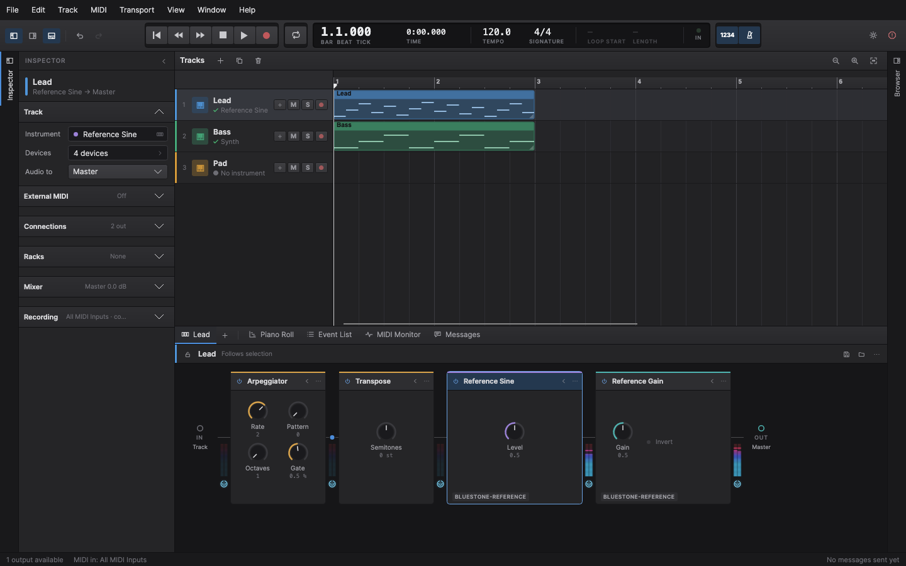

# Bluestone

[](https://github.com/djflan/Bluestone/actions/workflows/ci.yml)

Bluestone is a modern, open-source, device-centric digital audio workstation built for tight timing and accuracy. It brings hardware instruments, software instruments, effects, and note processors into one modular environment without making musicians work like routing engineers. Bluestone on its own is meant to be a complete virtual studio; plugins and hardware join it as peers.

Bluestone combines deep, flexible signal flow with clear, approachable workflows. Its interface is designed as a cohesive professional product: fresh, responsive, musically focused, and consistent across every feature.

> [!IMPORTANT]
> Bluestone is alpha software. It is usable for music production today and intended for musicians who enjoy adopting new creative tools early. Important production workflows are still incomplete, project formats may evolve, and several hardware and platform paths still need physical verification.



## The idea

Bluestone is for serious musicians, whatever their studio looks like: Bluestone alone, a plugin collection, or a room of synthesizers, boutique instruments, Eurorack systems, audio interfaces, and external effects. Each of those setups is a complete, first-class studio with the same timing and accuracy. It is aimed primarily at intermediate and professional musicians, producers, and studio owners, while keeping the common path approachable to committed amateurs.

Five priorities guide the product:

1. Tight timing, synchronization, latency handling, and accuracy.
2. Bluestone devices, third-party plugins, and hardware as equal participants, in any combination.
3. Deep modularity and extensibility.
4. Clear defaults, progressive disclosure, and approachable workflows.
5. A cohesive, contemporary, professional user experience.

The device chain is the everyday modular surface. Ordinary tracks keep familiar inputs, outputs, sends, faders, and sensible routes to the master. More advanced routing becomes visible when it is useful, not before. Automatic choices remain inspectable, editable, and reversible.

Read the full [product vision](docs/product-vision.md), the public [roadmap](docs/roadmap.md), and the agent-ready [Release 1.0 plan](docs/release-1.0.md).

## What works in the alpha

### Composition and MIDI

- A linear clip arrangement with move, copy, trim, split, consolidate, arranger loops, and note and audio clip loops.
- A piano roll with velocity and controller lanes, an event list, track automation, zooming, snapping, and keyboard editing.
- MIDI recording with count-in, metronome, punch, cycle recording, MIDI thru, and computer-keyboard input.
- Standard MIDI File import and export with diagnostics for anything that cannot be carried over.
- Core MIDI, WinMM, and ALSA MIDI output; Core MIDI and WinMM input; lossless SysEx preservation; and a built-in MIDI monitor.
- Data-defined hardware profiles for voices, banks, controllers, initialization, and parameters translated to CC, RPN, NRPN, or SysEx.

### Devices and routing

- Hybrid, instrument, audio, effect, and group tracks with nondestructive role conversion.
- Track and rack device chains with built-in Transpose, Event Filter, and Arpeggiator devices.
- A Browser and Device View for inserting, replacing, reordering, bypassing, and editing devices.
- Parallel note, control, protocol, and audio signals through a chain, allowing layered instruments and effects in either domain.
- Shared racks, group routing, mixer channels, sends, buses, master routing, and validation that refuses feedback loops.
- Device parameter automation and hardware-parameter automation.

### Audio and plugins

- An audio engine with one transport for MIDI, audio clips, plugin instruments, and plugin effects.
- WAVE and AIFF playback at any source rate, streamed from disk with clip gain, fades, and loops.
- A mixer console with gain, pan, mute, solo, buses, pre/post sends, and peak and RMS meters.
- Plugin latency compensation and a shorter render-ahead path for live plugin instruments.
- VST 3 and CLAP instruments, note effects, and audio effects hosted in worker processes.
- Per-module scanning and quarantine, saved plugin state, crash recovery, configurable hosting modes, and floating editors.
- A plugin failure can silence or restart the affected worker without taking the Bluestone application or project down with it.

### Projects and workspace

- Versioned project files with atomic saves, backups, recovery, and migrations that preserve older MIDI behavior.
- Missing plugins, hardware endpoints, and files retained as project intent rather than silently discarded.
- A dockable and detachable workspace with an inspector, Browser, Device Views, arranger, editors, mixer, MIDI monitor, and saved per-project layout.
- Undo and redo across musical, routing, mixer, device, and layout-adjacent project commands.

Detailed behavior is documented in [architecture.md](docs/architecture.md), [plugin-hosting.md](docs/plugin-hosting.md), [project-format.md](docs/project-format.md), [midi-files.md](docs/midi-files.md), [profiles.md](docs/profiles.md), and the [architecture decision records](docs/adr/).

Current shortcuts and workflows are collected in [Using the Bluestone alpha](docs/user-guide.md).

## Important gaps

The current alpha does not yet provide:

- audio input, audio recording, take lanes, or comping;
- importing audio through the application;
- mix, stem, or final-master export;
- a unified hardware-instrument device combining MIDI or CV output, audio return, profile, and latency correction;
- compressed audio playback;
- complete mixer, send, and device-automation drawing;
- MIDI input on Linux;
- a clip and scene launcher;
- a full modulation or generative environment;
- MIDI 2.0, MPE, or broad per-note expression; or
- physical verification of every audio, MIDI, plugin-editor, and multi-monitor path on every platform.

Worker processes provide plugin crash isolation, not an operating-system security sandbox. Plugins retain their normal file and network access; see [SECURITY.md](SECURITY.md).

## Direction to 1.0

The next major phase closes one complete production loop:

> Add a hardware or software instrument, record MIDI and audio, edit the performance, monitor it with correct latency, mix it, and export the finished result.

Work is organized around:

1. Core audio production: input, monitoring, recording, editing, takes, comping, mixdown, and stems.
2. First-class hardware devices: MIDI, audio returns, profiles, measured latency, clock, external effects, and later CV.
3. Deeper arranger, piano-roll, audio, and automation editing.
4. A small useful built-in device collection that defines the first-party device contract.
5. Continuous timing measurement, recovery testing, accessibility, and visual review.

The clip/scene launcher, full modulation system, large first-party device catalog, MIDI 2.0, and specialized legacy-format sequencing follow later unless deliberately reprioritized.

## Platform status

macOS is the current development platform. Windows x64 has also been built and tested on a native desktop, including software MIDI loopback, WASAPI output, installed plugins, and plugin editors. ASIO was tested only in an explicitly enabled local build and is excluded from standard Windows CI and releases pending licensing. No physical MIDI instrument or external audio interface was connected for those checks. Hosted Windows and Linux CI runners have no audio devices or installed third-party plugins.

| Platform | MIDI | Audio output | Plugins |
| -------- | ---- | ------------ | ------- |
| macOS, Apple silicon | Core MIDI output and timestamped input; hardware, IAC, network, and Bluestone virtual ports | Core Audio heard and measured | Installed VST 3 and CLAP plugins tested, including editors |
| Windows x64, native and CI; ARM64 build | WinMM output and input with SysEx; Windows MIDI Services loopback; computer keyboard input | WASAPI is built in standard Windows builds; ASIO was tested locally at its 960-frame/20 ms driver default but is excluded from standard builds pending licensing; audio not listened to, external RME not connected | Surge XT and Airwindows CLAP processing pass; Pro-Q 3 and Surge XT editors pass lifecycle and workspace tests; no physical MIDI instrument |
| Linux, x64 in CI | ALSA sequencer output with SysEx and a virtual port; computer keyboard input | ALSA built and automatically tested; not yet heard as part of the current verification record | Bluestone test plugins in CI; third-party editors not physically verified |

The Release 1.0 work begins by converting this into an explicit supported, experimental, and deferred matrix with measurable timing and latency gates.

Timing targets, the probes that judge them, and current measurements are in [ADR 0043](docs/adr/0043-timing-targets-and-measurement.md). On macOS the real-time work (audio rendered in the device callback, MIDI playback and thru, live input, and the plugin data plane) runs in a separate C# engine process compiled ahead of time with NativeAOT ([ADR 0044](docs/adr/0044-engine-process.md)). Measured on an Apple silicon Mac at 128 frames (2.7 ms), with the application process collecting garbage hundreds of times a minute, the engine:
- had no xruns;
- rendered in at most 0.26 ms;
- dispatched every scheduled MIDI message by its Core MIDI send-ahead deadline;
- played live notes from a Core MIDI input within the device's reported output latency plus one buffer period, plus at most 0.04 ms;
- did not collect garbage or compile code once.

A loopback capture agrees with the heard-time model within 0.4 ms. MIDI arrival at the receiver, immediate MIDI output, and MIDI thru have been measured through the engine only on macOS. On native x64 Windows, the high-resolution waitable timer measured 0.32 ms p50 and 0.87 ms p99 immediate WinMM dispatch lateness (0.902 ms max); spinning had a 3.067 ms maximum and 32 messages over 2 ms late. A Windows MIDI Services software loopback measured 0.077 ms median WinMM OS hop and 0.312 ms median thru round trip, with no dropped messages. Engine live input over that loopback averaged 9.5 ms added latency and peaked at 16.8 ms, above the 2 ms target, so the engine remains opt-in (`BLUESTONE_ENGINE=1`) on Windows and Linux. These software-loopback measurements do not establish physical-device clock accuracy or acoustic latency.

## Build and run

Bluestone is a C#/.NET application by default. Rust is reserved for measured real-time constraints and native interfaces, with small, versioned boundaries between the two. See [ADR 0026](docs/adr/0026-native-technology-policy.md) for the language policy.

Install the [.NET 10 SDK](https://dotnet.microsoft.com/download) required by `global.json` and Rust 1.88 or later. Linux also needs the ALSA development files. Standard Windows builds, CI, and releases use WASAPI only while ASIO licensing is pending. Do not enable the ASIO feature until the required Steinberg agreement is signed. For an explicitly enabled ASIO development build after signing, install LLVM with `libclang`, obtain ASIO SDK 2.3.4, set `CPAL_ASIO_DIR`, and pass `-p:BluestoneAsio=true`; always set the SDK path because `asio-sys` otherwise downloads its own copy. Windows ARM64 remains WASAPI-only. From the repository root:

```sh
dotnet restore src/dotnet/Bluestone.slnx
dotnet build src/dotnet/Bluestone.slnx
dotnet test src/dotnet/Bluestone.slnx
dotnet format src/dotnet/Bluestone.slnx --verify-no-changes
```

Run the desktop application with:

```sh
dotnet run --project src/dotnet/Bluestone.Desktop
```

`dotnet build` also builds the native audio and plugin-host crates. After changing Rust code, run `cargo fmt --check`, `cargo clippy --all-targets -- -D warnings`, and `cargo test` from `src/native/`.

The default automated suite requires no MIDI hardware, audio device, or installed plugins. Tests that require a real service or device skip with a reason. Timing probes and hardware checks are described in the [engineering handoff](docs/engineering-handoff.md) and [hardware test plan](docs/hardware-test-plan.md).

## Repository guide

```text
Bluestone/
├── docs/
│   ├── adr/                    Architecture decision records
│   ├── worklogs/               Historical milestone records
│   ├── product-vision.md       Product definition and decision principles
│   ├── roadmap.md              Public product priorities
│   ├── release-1.0.md          Agent-ready delivery slices and gates
│   ├── engineering-handoff.md  Current implementation notes and regression constraints
│   ├── user-guide.md            Current alpha workflows and shortcuts
│   ├── architecture.md         System structure and enduring technical principles
│   ├── plugin-hosting.md       Plugin processes, recovery, formats, and limits
│   ├── project-format.md       Project persistence and migrations
│   ├── midi-files.md           Standard MIDI File behavior
│   └── profiles.md             Hardware profile format
├── profiles/                   Shipped device-profile data
├── samples/                    Redistributable demos and fixtures
└── src/
    ├── dotnet/                 Application, domain, UI, adapters, and tests
    └── native/                 Rust audio, plugin host, and test-plugin crates
```

Engineering decisions belong in an ADR. Current implementation traps, frozen regression fixtures, and unverified paths belong in the engineering handoff. Product priorities belong in the roadmap; do not use a worklog as current direction.

## Contributing

Contributions are welcome. Start with [CONTRIBUTING.md](CONTRIBUTING.md), the [product vision](docs/product-vision.md), and the relevant Release 1.0 slice. New work should preserve timing and project correctness, fit the shared interaction and visual system, and state clearly which behavior was simulated and which was verified on real hardware.

## Third-party names and trademarks

Bluestone is independent and is not affiliated with, sponsored, endorsed, or authorized by the owners of the products, formats, and standards it names. Those names identify what Bluestone works with, was tested against, or used as a workflow reference. See [TRADEMARKS.md](TRADEMARKS.md).

## Supporting Bluestone

If Bluestone is useful to you, you can support its development through [Ko-fi](https://ko-fi.com/djflan) or [GitHub Sponsors](https://github.com/sponsors/djflan).

## License

Bluestone is released under the [MIT License](LICENSE).
