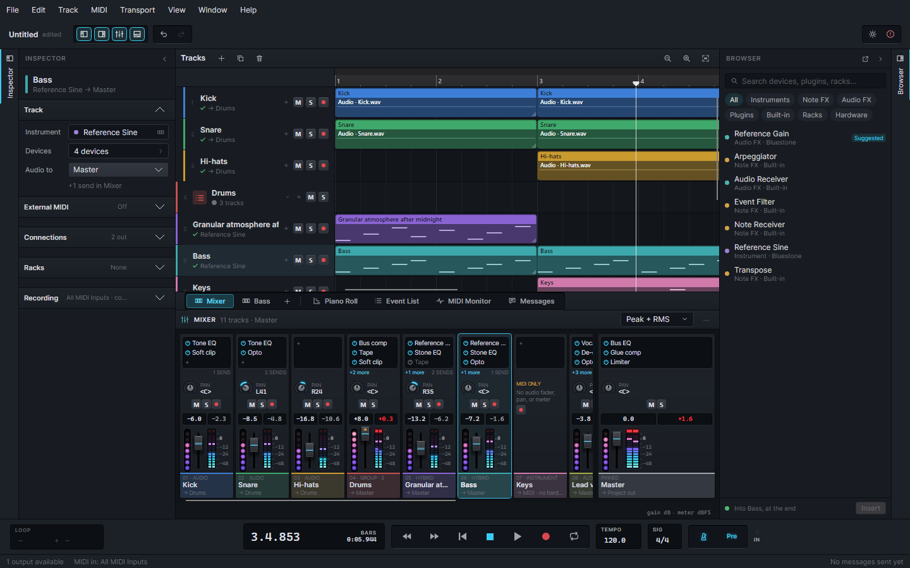
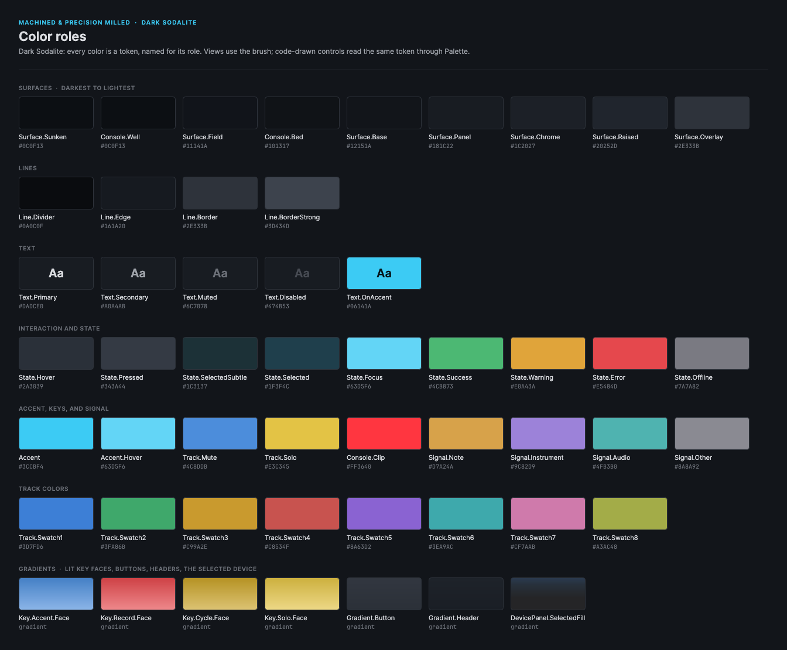
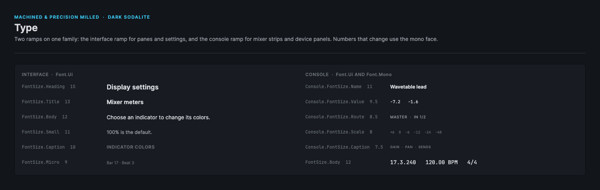
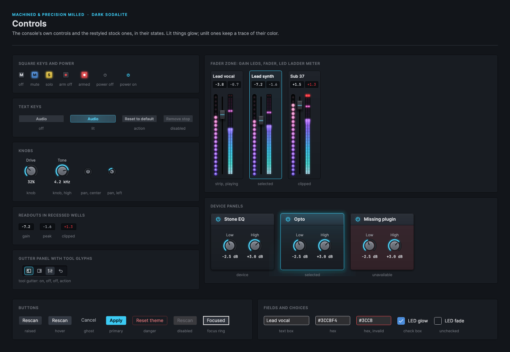
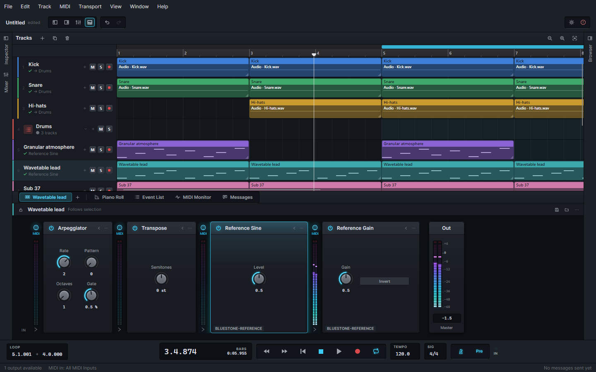

# Machined & Precision Milled: the Bluestone design language

Bluestone's interface is designed as one instrument, not a collection of screens. This guide is the written form of
that design: the principles, roles, controls, and rules every visible change follows. It is normative for visible UI
([ADR 0052](adr/0052-design-language.md)). The values (colors, gradients) live in the theme and
`src/dotnet/Bluestone.Desktop/Theme/Tokens.axaml`; this guide names them by token key and never repeats them.

The name says what we aim for. Every surface should look **machined and precision milled**: cut cleanly, aligned
exactly, finished to a professional standard, and built to be trusted for hours. The default theme is
**Dark Sodalite** ([ADR 0053](adr/0053-themes.md)).

## Quick-start checklist

Before you open a pull request with a visible change, check each item:

1. Every color, font, size, radius, height, shadow, and duration comes from a token key. No raw values.
2. You reused a control or style class from the [catalog](#9-control-catalog) before writing a new one.
3. Color means something (selection, state, track identity, or signal kind), and it is never the only cue.
4. Light marks real, live state only.
5. Geometry is fixed: nothing moves, resizes, or reflows on hover, selection, or playback.
6. Text uses the type ramp; numbers and time use `Font.Mono`.
7. Every [state](#10-states) is defined: rest, hover, pressed, focus, selected, disabled, and offline or error where
   they apply.
8. Every focusable control shows a visible focus ring, and every icon-only control has a screen-reader name.
9. Copy is US English, sentence case, in a musician's words.
10. You looked at the change in the running app at compact and normal window sizes, and the PR shows it.

## Authority and change

- **ADRs decide.** This guide states the rules and the intent. The theme and `Tokens.axaml` hold the values.
- **When the guide and the code disagree**, the same pull request fixes whichever is wrong.
- **Keep it true.** A pull request that adds, renames, or removes a token, a theme member, or a public control in
  `Controls/`, or that changes a rule here, updates this guide in the same pull request. UI tests fail when a token or
  control named here no longer exists, or a control is missing from the catalog.
- **Tiers.** Work inside this language is material or routine UI
  ([governance](../.github/skills/team/references/governance.md#ui-change-tiers)). Changing the language itself (a new
  principle, material, control family, or theme direction) is directional and needs the maintainer's approval.

## 1. Principles

1. **Lit means live.** Light reports real state: signal, notes held, armed, selected, latched, clipping. A musician who
   learns that light always means something never misses the light that says "you're clipping."
2. **Calm until touched.** Surfaces stay quiet so the music, the meters, and the selection are the brightest things on
   screen. Eight hours in, the eyes should not be tired.
3. **Hardware honesty.** Controls behave like what they look like and report the truth: measured levels, real units,
   no faders that do nothing. When something can't work, say so in words.
4. **Fixed geometry, muscle memory.** Panels, strips, rows, and keys keep their size and place, and numbers keep their
   width. Mid-take, a musician hits **S** without looking.
5. **Every device wears the same panel.** Bluestone devices, plugins, and hardware share the same cards, junctions,
   and controls. A Bluestone-only studio looks exactly as finished as one full of gear.
6. **Precision you can read.** Monospaced values, labeled scales, dense but legible layouts. Fine adjustment is
   always available (Shift-drag, arrow keys, and a typed value where a field is offered).
7. **Progressive depth.** The common path is calm and obvious; deeper control is one clear step away, never in the way
   ([product vision](product-vision.md#progressive-depth)).
8. **A professional finish everywhere.** Edges align to the pixel grid, spacing follows the scale, every state is
   designed. A small dialog gets the same care as the mixer.

## 2. Materials

The interface is built from a few materials, darkest to lightest:

| Material | Tokens | Use |
|---|---|---|
| Well | `Console.Well`, `Surface.Sunken` | The deepest cut: readouts, meter beds, insert lists (`RecessedWell`) |
| Gutter | `Console.Gutter`, `Surface.Field` | Recessed strips that hold glyph keys and fields (`GutterPanel`) |
| Bed | `Console.Bed` | What console strips and device cards sit on |
| Base | `Surface.Base` | The workspace: lanes, editors, page backgrounds |
| Panel | `Surface.Panel`, `Surface.Chrome` | Panes, headers, bars, strips, and device cards |
| Raised | `Surface.Raised`, `Console.Key` | Keys, buttons, and headers that stand above the panel |
| Overlay | `Surface.Overlay`, `Overlay.Scrim` | Popovers and menus over the workspace |

- **Hairlines, not floating cards.** Regions are divided by `Line.Divider` and `Line.Border`, not by gaps and shadows.
  The device card is the one panel with a drop shadow; popovers use `Shadow.Popover`.
- **Cut in, don't stack up.** A readout, meter, or glyph group is cut into its panel (well or gutter), not placed on top
  of it in a box.
- **Light from above.** Bars and headers are faintly lit from above (`Gradient.Bar`, `Gradient.Header`); a panel's
  sheen is `Console.SheenAlpha` at most. Never more.

## 3. Color roles

Color is reserved for meaning. Every hue on screen answers "what does this tell me?"

| Role | Tokens | Means |
|---|---|---|
| Accent | `Accent`, `Accent.Hover`, `State.Selected`, `State.SelectedSubtle` | Selection, focus, and "on" for interface toggles |
| Signal | `Signal.Note`, `Signal.Instrument`, `Signal.Audio`, `Signal.Other` | What a device works on |
| Track | the track colors (`Track.Swatch1Color` to `Track.Swatch8Color`) | Which track something belongs to |
| State | `State.Warning`, `State.Error`, `State.Success`, `State.Offline` | Health and problems, always with words or a glyph |
| Transport | `Key.Record.Face`, `Key.Cycle.Face`, `Track.Mute`, `Track.Solo` | Record, loop, mute, and solo: the colors musicians already know |
| Level | the theme's meter gradients; `Console.Clip` | Signal level, low to high; the clip lamp is one fixed color, never part of a gradient |
| Text | `Text.Primary`, `Text.Secondary`, `Text.Muted`, `Text.Disabled` | Hierarchy: primary content, supporting labels, optional detail, unavailable |

Rules:

- **Never add a hue without a role.** A new color needs a token, a role in this table, and a reason.
- **Color is never the only cue.** Mute, solo, arm, offline, error, and signal kind also carry a glyph, a letter, or a
  word.
- **Accent means the interface; signal colors mean the music.** Don't use the accent to mark a device, or a signal
  color to mark selection.
- **The meter gradients belong to the theme**, and the musician can edit them in Settings ▸ Display. Draw levels through
  `Theme/MeterGradient.cs`, never from fixed colors.

## 4. Illumination

Lit things behave like real light, restrained and purposeful.

- **Lit versus unlit.** An LED, lamp, or cell that is off keeps `Console.UnlitAlpha` of its color, so the musician can
  see what *could* light.
- **Workspace toolbar toggles** use the transport's accent-lit glyphs and LED fade, without selected faces or rims.
  Their existing targets and glyph centers stay fixed; the unpainted faces leave quiet space between icons.
- **Glow only through `Theme/Glow.cs` and `Theme/LedLight.cs`**, at `Console.GlowAlpha` and `Console.GlowReach`, and
  always honoring the musician's **LED glow** setting and **Glow strength**. Glow strength includes off.
- **LED ladders** (`LedLadderMeter`, `GainLedGutter`) light cell by cell; they never draw a smooth bar.
- **Lit keys light their whole face.** A latched `SquareKey` shows its state across the face (`Key.Accent.Face`,
  `Key.Record.Face`, `Key.Solo.Face`, `Key.Cycle.Face`) with a lit rim and `Key.LitInk` glyphs. No side LED.
- **Focus lighting.** Only the selected device panel is lit (`DevicePanel.SelectedFill`); the rest stay calm.
- **A selection halo is not light.** `Shadow.AccentGlow` marks a selected tile or open chip; it is not an LED and
  doesn't follow the glow setting.
- **Never glow** text, panels, borders, or anything idle.

## 5. Typography

- **Fonts are fixed** and shipped with Bluestone: `Font.Ui` (Inter) for the interface and `Font.Mono` (JetBrains Mono)
  for numbers, time, and hex values, both with Noto Music for musical symbols. Use the tokens, never a font name.
  There is no font choice.
- **The UI ramp:** `FontSize.Micro`, `FontSize.Caption`, `FontSize.Small`, `FontSize.Body` (the default),
  `FontSize.Title`, `FontSize.Heading`. Nothing between the steps.
- **The console ramp** (`Console.FontSize.Caption`, `Console.FontSize.Scale`, `Console.FontSize.Route`,
  `Console.FontSize.Value`, `Console.FontSize.Name`) is for mixer strips and device panels only.
- **Readable floor.** `FontSize.Micro` is the smallest text a musician must read to act. Console sizes below it are
  allowed only when the text repeats information available elsewhere (a tooltip, the inspector, or the screen-reader
  name), meets the contrast floor, and is never a control's only label.
- **Hierarchy by weight and color**, not by size alone: a title is `Text.Primary`; supporting text is `Text.Secondary`.

- **Section captions** may be small caps or capitals as a style (for example **INDICATOR COLORS**); screen-reader names
  stay in sentence case.

## 6. Spacing, density, and geometry

- **The spacing scale:** `Space.XXS` and `Space.XS` inside a control; `Space.S` and `Space.M`
  between sibling controls; `Space.L` between groups; `Space.XL` and `Space.XXL` between sections and at page margins.
  Use the named `Inset.*` thicknesses for panel, section, header, and row padding.
- **Standard heights:** `Height.Control` for controls, `Height.Compact` for dense rows of controls, `Height.Row` for
  list and track rows, `Height.Header` for pane headers, `Height.Tab` for tabs, `Height.ControlBar` and
  `Height.StatusBar` for the bars, and `Width.Rail` for the side rails.
- **Fixed instrument geometry.** Device panels have one height (`DevicePanel.Height`) and a few widths
  (`DevicePanel.CollapsedWidth`, `DevicePanel.SmallWidth`, `DevicePanel.MediumWidth`, `DevicePanel.LargeWidth`).
  Mixer strips have one pitch (`Mixer.StripWidth`) and stack fixed bands so every strip's controls line up across the
  console. These never stretch to fill space.
- **Dense, not cramped.** Bluestone is a professional tool and shows a lot at once, but every element keeps its scale
  spacing. Avoid airy web-style padding and large rounded cards.
- **Two sizes to check:** compact (a laptop, about 1320×850) and normal (about 1620×1000). Both must work; the mixer
  folds its bands by the `Mixer.RoomyStripHeight` and `Mixer.FullStripHeight` tiers rather than shrinking text.
- **Pixel grid.** Hairlines and edges land on whole device pixels (see `Controls/ConsolePaint.cs`).

## 7. Radii, lines, and shadows

- **Radii:** `Radius.Small` for chips and small keys, `Radius.Control` for controls, `Radius.Panel` for panels and
  popovers, `Radius.Round` for pills and round lamps, `Radius.None` where regions meet. Precision-milled corners are
  small; don't round more.
- **Lines:** `Line.Divider` between regions, `Line.Border` around controls, `Line.BorderStrong` for emphasis,
  `Line.Edge` for the lit top edge of a raised surface.
- **Shadows:** `Shadow.Popover` for things lifted over the workspace, `Shadow.Inset` for readouts cut into a panel,
  `Shadow.Focus` for focus, `Shadow.AccentGlow` and `Shadow.AccentGlowTight` for selection halos. No other shadows.

## 8. Iconography

- Icons are drawn on a **16-unit grid** as `StreamGeometry` resources in `Theme/Bluestone.axaml` (`Icon.Play`,
  `Icon.Mixer`, …). Filled by default; outline icons use `PathIcon.stroke`.
- Sizes come from `Icon.SizeSmall`, `Icon.SizeMedium`, and `Icon.SizeLarge` only.
- Icons are **monochrome** (`Control.Foreground`); they take a color only to show state (for example a lit transport
  glyph). No third-party logos, icons, or product artwork ([TRADEMARKS.md](../TRADEMARKS.md)).

## 9. Control catalog

Reuse before you build. Use stock Fluent controls (`ComboBox`, `TextBox`, `CheckBox`, `NumericUpDown`, menus) on forms
and settings pages, where they are restyled globally; don't restyle them per view. Use Bluestone controls on instrument
surfaces: the mixer, device panels, and transport. A new control needs a reason the catalog can't meet, a contract
(purpose, states, keyboard and precision input, sizes from tokens), and a review by Max and Iris.

| Control | Use it for | Don't use it for |
|---|---|---|
| `GutterPanel` | Recessed strips of chromeless glyph keys (toolbar, transport, tool groups) | Forms or content panes |
| `RecessedWell` | Readouts, meter beds, insert lists | Editable fields (use `TextBox.field`) |
| `DeviceCardPanel` | Device cards in a chain, with the lit selected state | Generic cards; Bluestone has none |
| `ConsoleStripPanel`, `TrackFooterBand` | A console strip's face; its track-color name plate | Anything outside the console |
| `SquareKey` | Mute, solo, record-arm, and monitor keys | Mode switches (use `TextKey`); the transport, whose toggles are styled buttons with `LedFade` glyphs in a `GutterPanel` |
| `TextKey` | Labelled mode switches (Auto, Limiter) and page actions | Picking one of several options (use a segmented choice) |
| `PowerGlyph` | Enable and bypass | Ordinary on/off settings (use `CheckBox`) |
| `Knob`, `PanKnob` | Device parameters; a strip's pan | Values that must be typed exactly (add a field) |
| `ConsoleFader`, `GainLedGutter`, `LedLadderMeter`, `ConsoleScale` | Gain and level on the console's dB taper | Non-dB values or progress (use `ProgressBar`) |
| `ChainJunction`, `ChainOutMeter` | The seams between devices and the Out card | Anything that isn't a device seam |
| `LedFade` | A lit glyph over its dark twin, for styled keys that can't draw their own fade | Controls that draw their own fade |
| `IndicatorPreview` | A still sample of an indicator family in Settings ▸ Display | Live meters |
| `ColourPicker`, `ColourPickerPopup`, `ColourWheel`, `BrightnessFader` | Editing one theme color | Choosing among fixed options |
| `TimelineView`, `RulerView`, `PlayheadOverlay`, `PianoRollView` | The arrangement and editors | Other views |
| `ResizeHandle` | Resizing a docked region | Splitters inside a panel |
| `StoneMark`, `MarbleSlab` | The brand: splash and About only | Any working surface |

Painting and support types, used by the controls above and not placed directly: `ArcKnobPaint`, `ConsolePaint`,
`ConsoleRail`, `MixerRail`, `MixerValueControl`, `LedLevels`, `LedMotion`, `LadderLevels`, `SignalLevelMetrics`,
`SignalDescription`, `TimeGrid`, `ColourHsv`.

**Style classes** in `Theme/Bluestone.axaml` are the shared vocabulary:

- **Layout:** `Border.pane`, `Border.bar`, `Border.header`, `Border.hairline`, `Border.separator`, `Border.chip`,
  `Border.badge`, `Border.lcd`, `Border.segmented`, `Border.rail`.
- **Text:** `TextBlock.title`, `TextBlock.overline`, `TextBlock.secondary`, `TextBlock.muted`, `TextBlock.label`,
  `TextBlock.caption`, `TextBlock.micro`, `TextBlock.fieldLabel`, `TextBlock.fieldValue`.
- **Buttons:** `Button.raised`, `Button.ghost`, `Button.link`, `Button.primary`, `Button.danger`, `Button.tool`,
  `Button.value`, `Button.compact`, `Button.swatch`.
- **Choices and fields:** `RadioButton.tab`, `RadioButton.segment`, `Expander.section`, `ListBox.dense`,
  `TextBox.field`, `TextBox.cell`, `TextBox.inline`, `TextBox.lcd`, `PathIcon.stroke`, `StackPanel.emptyState`.

Classes prefixed `mixer`, `chain`, `source`, `settings`, or `sc` belong to one view. Don't reuse them elsewhere; promote
a pattern to a shared class (and this list) when a second view needs it.

## 10. States

Every interactive control defines each state that applies to it, with tokens:

| State | Tokens | Notes |
|---|---|---|
| Rest | `Surface.*`, `Text.Secondary` or `Control.Foreground` | Quiet |
| Hover | `State.Hover`, `Control.Hover` | Answers before it is chosen; never changes size |
| Pressed | `State.Pressed`, `Control.Pressed` | |
| Focus | `State.Focus`; `State.FocusOnLit` on controls whose "on" state is already an aqua rim | See [accessibility](#14-accessibility-floor) |
| Selected | `State.Selected`, `State.SelectedSubtle`, `TrackRow.Selected` | Accent-tinted surface, never only a color change of text |
| Latched or lit | `Key.*.Face`, `Key.*.Rim`, `Key.LitInk` | See [illumination](#4-illumination) |
| Disabled | `Text.Disabled` | Explain why when it isn't obvious (a tooltip or a line of text) |
| Offline or error | `State.Offline`, `State.Error`, `State.ErrorSurface`, `Track.Offline` | Always with words or a glyph |

## 11. Motion

- Motion only explains a change. Durations come from `Motion.Fast`, `Motion.Normal`, and `Motion.LampRelease`.
- LEDs warm up and fade through `Controls/LedMotion.cs`, following the **LED fade** and **LED warm-up** settings.
- When the system asks for reduced motion, every change lands at once.
- Nothing moves during playback except the playhead, meters, and lights.
- `StoneMark` animation belongs to the splash and About only.

## 12. Workspace regions

The window has fixed semantic regions ([ADR 0036](adr/0036-semantic-workspace-and-device-view.md)): the toolbar, the
arrangement, the inspector, the Browser, the editors and Device View, the Mixer, the transport bar, and the status line,
with Settings as a popover ([ADR 0051](adr/0051-settings-popover.md)). Use these names, as the
[user guide](user-guide.md) does. A new view joins a region; it doesn't invent free-floating docking.

## 13. Copy and voice

- **US English** ("color", "center"). **Sentence case** for labels, buttons, menu items, tooltips, and screen-reader
  names.
- **A musician's words.** "Mixer meters", not "MixerGradient". Technical names appear only when they identify a real
  device, protocol, or diagnostic.
- **Units always**: dB, ms, Hz, %, bars and beats.
- **Errors say three things**: what happened, what is still safe, and what the musician can do next.
- **Shortcuts** are written "Ctrl/Cmd + ,".

## 14. Accessibility floor

- **Contrast:** text a musician reads is at least 4.5:1 against the surface it sits on. Large text (18.66 px bold or
  24 px), icons, focus rings, and borders that carry meaning are at least 3:1. Glyphs on lit key faces meet 4.5:1
  against the darkest stop of the face.
- **Focus:** every focusable control shows a ring on keyboard focus, using `State.Focus` (or `State.FocusOnLit`), at
  least 2 px and 3:1 against its neighbors, never clipped by a container (`Inset.FocusRingOutset`). Removing the default
  focus adorner requires drawing a replacement.
- **Hit targets:** at least 24×24 px. A smaller target passes only if a 24 px circle centered on it overlaps no other
  target or circle, or another control in the same view that meets 24×24 does the same thing (WCAG 2.5.8).
- **Keyboard:** every action works from the keyboard in a logical tab order; Escape closes transient UI. Custom-drawn
  controls expose their role, value, and checked state through an automation peer.
- **Screen readers:** every interactive control and every icon-only button has an `AutomationProperties.Name` in
  sentence case. Live announcements are polite and throttled, as the status line's are.
- **Reduced motion** is honored (see [motion](#11-motion)).
- **Scaling:** at 100%, 150%, and 200% display scaling and the compact window size, no text or control is clipped,
  overlaps, or becomes unreachable.

## 15. Do and don't

| Do | Don't |
|---|---|
| Light a key's face when it latches | Make idle panels, text, or borders glow |
| Cut readouts into wells | Put a readout in a floating box with a shadow |
| Keep a strip's width when its name is long; truncate with a tooltip | Let a control grow on hover or selection |
| Use `Font.Mono` for every value that changes while you watch | Let digits jump in width during playback |
| Say "Keys: MIDI only, no hardware destination" | Show a fader that does nothing |
| Draw a plugin, a hardware device, and a Bluestone device in the same card | Style plugins or hardware as second-class |
| Name tokens and classes | Paste a hex value, a font name, or a pixel size |
| Use the stock `ComboBox` on a settings page | Restyle a stock control for one view |

## 16. Themes

A theme ([ADR 0053](adr/0053-themes.md)) holds values only: every color token, the three meter gradients, the MIDI
light color, and a **variant** (Light, Midtoned, or Dark) that describes its overall scheme. It can't change roles,
geometry, type, or any rule in this guide.

- **Dark Sodalite** is the default and the only theme Bluestone ships, variant Dark: cool slate surfaces divided by
  hairlines, with a few points of light, like the stone. Its shipped values are the colors in `Tokens.axaml` and the
  gradient and MIDI defaults.
- A theme is a JSON file in the settings folder (`themes/dark-sodalite.json`) holding only what differs from the
  shipped theme, so improvements to the shipped colors reach everything nobody changed. Settings writes it: editing a
  gradient or the MIDI light saves into the theme, and **Reset theme** puts every member back. The file is Bluestone's;
  editing it by hand is at your own risk, and a file Bluestone can't read falls back to the default theme.
- **Adding a color:** add a Color token (and its brush) to `Tokens.axaml` with a semantic name and a role in
  [section 3](#3-color-roles); read it in custom-drawn controls through `Theme/Palette.cs`. The theme picks it up
  automatically, and a UI test checks that every token brush follows its theme color. A gradient or shadow token must
  also be listed in `ThemeApplier.GradientSources` or `ThemeApplier.ShadowSources`.
- **A future Light or Midtoned theme** must keep every role readable: the contrast floor applies to every theme, and a
  role keeps its meaning (accent is still selection; red is still record and clip).

## 17. Extending

- **A token:** a semantic name (`Role.Purpose`), a place in this guide, and no duplicates of an existing role.
- **A control:** check the catalog; write its contract; build it from tokens; add it to the catalog in the same pull
  request; get Max's and Iris's review.
- **A specimen:** `DesignSpecimenTests` renders the type ramp, color roles, and controls in their states. Run it with
  `BLUESTONE_WRITE_SPECIMENS=1` to refresh the images in `docs/images/design-language/` when a control or token changes.

## 18. Known gaps

These parts of the current interface don't meet this guide yet. They are tracked in
[engineering-handoff section 7](engineering-handoff.md#7-unresolved-implementation-backlog) for a follow-up material UI
change, and new work must not copy them:

- **Contrast below the floor:** `Text.Muted` on every surface (3.1–3.9:1; 2.6:1 on `Surface.Overlay`), including the
  console's smallest captions; `Key.LitInk` on the record face's top stop (4.1:1); `State.Error` on `State.ErrorSurface`
  (3.8:1). `Track.Offline` (2.8–4.1:1) passes as an icon on panels but must not be used for text or on overlays.
- **Focus:** the default focus ring is 1 px, and on aqua-rimmed controls it is hard to see; `Shadow.Focus` is a
  different blue from `State.Focus`.
- **Colors outside the theme:** some custom-drawn surfaces still use fixed colors (the knob cap and face, the fader
  body, the timeline, the time grid, the piano roll, and the shortcut sheet); they don't follow a theme until they move
  to tokens. The UI test that forbids raw colors lists each one.
- **Light outside the glow setting:** the armed track key glows through `Shadow.RecordGlow`, which ignores the LED
  glow setting.
- **Hit targets:** the mixer's M, S, and arm keys are 15 px with 1 px spacing.
- **Typed values:** knobs have no typed entry.
- **Motion:** style transitions use raw durations rather than `Motion.Fast` and `Motion.Normal`, and ignore reduced
  motion; only LEDs honor it.
- **Off-ramp sizes:** a few font sizes and many layout sizes in `MainWindow.axaml` and `Theme/Bluestone.axaml` are raw
  numbers rather than tokens.
- **Naming:** `Key.Accent.Face` is blue rather than the accent; the transport's loop toggle and the loop key use
  different colors; component tokens repeat values instead of referring to a base token.
- **Named colors:** code still uses `Colors.White`, `Colors.Black`, and similar named colors for shading; the raw-color
  test doesn't catch them.
- **Escape:** while the Reset theme confirmation is open, Escape closes Settings rather than the question (nothing is
  reset).
- **Spelling:** code identifiers still say "Colour" (`ColourPicker`, `LedColours`); new code says "Color".
- **Themes:** no theme picker, no live theme switching, and no Light or Midtoned theme yet.

## Glossary

- **Bed:** the surface console strips and device cards sit on.
- **Gutter:** a recessed strip that holds glyph keys or LEDs.
- **Junction:** the seam between two devices in a chain, showing the signal that passes.
- **Key:** a square or text button with a physical face that can latch and light.
- **Ladder:** an LED meter made of separate cells.
- **Lamp:** a single indicator light (clip, MIDI, note).
- **Plate:** the track-color name plate at the foot of a strip.
- **Well:** the deepest recess, holding readouts and meters.
